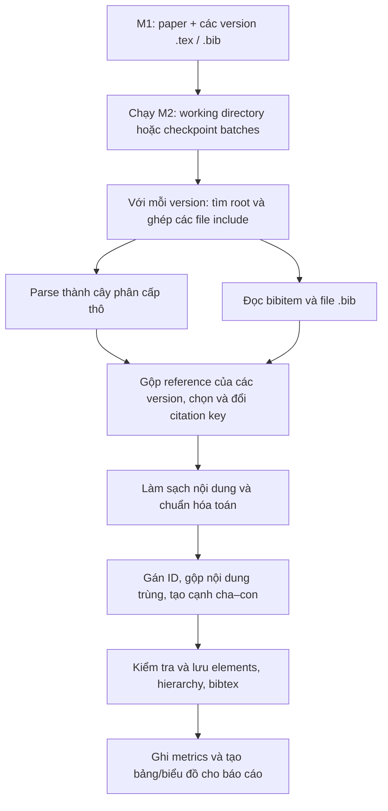
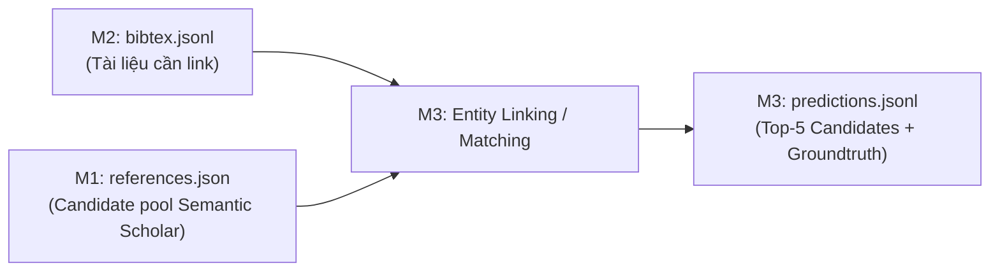

# Kiến trúc Milestone 2: Parsing và Standardization

Tài liệu này giải thích M2 nhận gì từ M1, xử lý theo thứ tự nào, tạo ra dữ liệu gì và chức năng nằm ở hàm nào. Tên hàm bắt đầu bằng `_` là hàm nội bộ/helper. Tài liệu mô tả **code hiện tại**, kể cả những giới hạn chưa xử lý hết.

- Đề của thầy: [Milestone 2 — Hierarchical Parsing and Standardization](https://hcmus-cs-ta.github.io/lab-book/intro-ds/statement/parsing/).
- Hướng dẫn chạy trên máy: [HUONG_DAN_CHAY_M2.md](../../HUONG_DAN_CHAY_M2.md).
- README tổng quan của module: [README.md](README.md).

## 1. M2 có nhiệm vụ gì?

M1 thu thập metadata, source `.tex`/`.bib` và references Semantic Scholar. M2 lấy **source LaTeX của từng version**, xác định những file được sử dụng, biến nội dung thành cây phân cấp, chuẩn hóa, gộp phần trùng và xuất ba bảng `elements`, `hierarchy`, `bibtex` cho bước sau.

Đề yêu cầu xử lý từng publication và từng version; version M1 ghi rỗng vẫn phải xuất hiện trong thống kê. References Semantic Scholar của M1 nằm riêng, không phải là bảng `bibtex` được trích từ source ở M2.

### Đối chiếu nhanh với yêu cầu của thầy

| Yêu cầu | Phần xử lý chính | Kết quả |
| --- | --- | --- |
| Tìm file chính và các file được include | `gather.py` | Nội dung LaTeX theo compilation path |
| Xây cây Document → Section → thành phần nhỏ hơn | `hierarchy.py` | Một cây `ParseNode` cho mỗi version |
| Làm sạch lệnh định dạng, chuẩn hóa toán | `cleanup.py` | Nội dung đã làm sạch trước khi gộp |
| Đọc `.bib`, chuyển `\bibitem` | `bibitem.py` | Danh sách reference của từng version |
| Gộp reference, đổi citation key | `dedup.py` | BibTeX chung của publication và ánh xạ key |
| Gộp nội dung giống nhau giữa các version | `dedup.py` | Element ID dùng lại và cạnh theo version |
| Tạo, kiểm tra ba bảng | `tables.py`, `pipeline.py` | `elements.jsonl`, `hierarchy.jsonl`, `bibtex.jsonl` |
| Thống kê, hiệu suất và báo cáo | `pipeline.py`, `batch_pipeline.py`, `report_m2.ipynb` | `metrics_m2.json` và notebook báo cáo |

Các mục trong bảng là **vị trí chức năng**, không phải khẳng định đã xử lý đúng mọi dạng LaTeX. Những giới hạn cụ thể nằm ở mục 12.

## 2. Sơ đồ luồng tổng thể



**Thứ tự trong code:** parser dựng cây thô trước. Sau khi đã thu thập reference của mọi version trong một bài, chương trình gộp reference và đổi citation key trong cây, sau đó làm sạch nội dung để gán ID và gộp element.

## 3. Đầu vào và điểm bắt đầu chương trình

### Đầu vào đã giải nén

Mỗi bài có một thư mục trong `data/working`, ví dụ `2609-37834`. Mỗi version có `v1/sources/`, `v2/sources/`... chứa `.tex` và `.bib`. Nếu M1 đã ghi version rỗng thì version có `empty.json`.

### Đầu vào checkpoint

Với dữ liệu nhóm hiện tại, M1 còn được lưu trong `batch_*.tar.gz` và file manifest `batch_*.json`. Manifest chứa danh sách ID và checksum. Bộ đã phục hồi 5 bài trên máy hiện tại nằm ở `data/range_1_repaired`.

### Hàm điều phối

| Chức năng | File | Hàm chính | Hàm liên quan / helper |
| --- | --- | --- | --- |
| Nhận lệnh và chọn chế độ chạy | `run_m2.py` | `main()` | `parse_args()` |
| Chạy toàn bộ từ các thư mục working | `pipeline.py` | `run_milestone2()` | `_iter_publications()`, `list_local_versions()`, `_publication_dir()`, `_version_source_dir()` |
| Chạy theo checkpoint và ghép kết quả | `batch_pipeline.py` | `run_checkpoint_batches()` | `_process_batch()`, `sample_total_rss()` |
| Kiểm tra checksum và khôi phục file working từ một batch | `archive_input.py` | `restore_batch()` | `restore_batches()` để khôi phục nhiều batch |
| Gọi xử lý riêng một publication từ code | `pipeline.py` | `parse_one_publication()` | `parse_one_version()`, `collect_version_bibtex()`, `_finalize_publication()` |

`run_milestone2()` tự lặp qua publication và version; nó không gọi `parse_one_publication()` trong luồng chạy toàn bộ. Hàm `parse_one_publication()` là API tiện dụng cho một bài.

Với `--batch-dir`, `_process_batch()` khôi phục checkpoint rồi gọi `run_milestone2()` cho các ID trong batch. Với `--resume`, code dùng lại batch nếu marker hoàn tất, checksum archive, phiên bản pipeline và các file kết quả phù hợp. Kết quả mỗi batch sau đó được ghép vào ba bảng tổng.

## 4. Yêu cầu: Multi-file Gathering

### Làm gì?

1. Tìm `.tex` chứa `\documentclass` để chọn file root. Nếu có nhiều ứng viên, code dùng heuristic để chọn và ghi log.
2. Theo các lệnh `\input` và `\include` từ root, kể cả các include lồng nhau. Lệnh nằm trong comment không được xem là include.
3. Ghép nội dung vào vị trí include; một file được include nhiều lần có thể được mở rộng nhiều lần. Khi gặp vòng include, code dừng nhánh đệ quy đó.
4. Ghi nhận các file `.tex` không nằm trong compilation path là file không sử dụng.

### Hàm trong `gather.py`

| Chức năng | Hàm chính | Helper |
| --- | --- | --- |
| Tìm file root | `find_document_root()` | `strip_tex_line_comments()`, `_read_tex()`, `_root_score()`, `_title_words()` |
| Lọc comment và nhánh điều kiện đã xác định | `active_tex()` | `emit()`, `_is_escaped()` |
| Lấy mục tiêu include và tìm file tương ứng | `extract_include_targets()`, `resolve_include_path()` | `strip_tex_line_comments()`, `_is_escaped()` |
| Liệt kê compilation path | `compilation_path()` | `find_document_root()`, `extract_include_targets()`, `resolve_include_path()`, `walk()` |
| Mở rộng nội dung file theo vị trí include | `concatenate_compilation_tex()` | `_expand_file()`, `_expand_includes()`, `resolve_include_path()`, `_read_tex()` |
| Tìm file `.tex` không dùng | `unused_tex_files()` | `compilation_path()` khi chưa có danh sách file đã dùng |

`parse_one_version()` trong `pipeline.py` nối các bước trên và truyền chuỗi LaTeX đã ghép sang parser. Nếu include không tìm thấy, code ghi version là `partial`, kèm danh sách `missing_includes`, và giữ kết quả nội dung đã đọc được. `active_tex()` lọc một số nhánh điều kiện đã xác định; điều kiện không xác định được giữ lại thay vì đoán nhánh thực thi.

## 5. Yêu cầu: Hierarchy Construction

### Cấu trúc cây

Parser tạo root `document`, bên dưới là heading và các thành phần tùy theo cấu trúc bài:

```text
document
└── heading: Introduction
    ├── paragraph
    │   ├── sentence
    │   └── sentence
    ├── formula
    ├── figure          # table cũng được lưu là figure
    └── list
        └── list_item
            └── paragraph → sentence
```

Heading có thể lồng nhau theo `section`, `subsection`... Parser có xử lý phần cảm ơn và phụ lục; bỏ section References/Bibliography khỏi cây nội dung. Các dấu câu trong toán, lệnh LaTeX, chữ viết tắt, URL và số thập phân được xử lý để hạn chế tách sai câu.

### Hàm và class trong `hierarchy.py`

| Chức năng | Hàm chính | Helper |
| --- | --- | --- |
| Đại diện một node trong cây | `ParseNode` | `ParseNode.to_dict()` |
| Tạo cây từ LaTeX | `parse_tex_to_tree()` | `_extract_title()`, `_document_body()`, `_HierarchyParser.parse()` |
| Duyệt từng phần nội dung | `_HierarchyParser.parse()` | `_HierarchyParser._step()`, `_HierarchyParser._handle_command()`, `_HierarchyParser._handle_begin()` |
| Xử lý heading và xác định cấp | `_HierarchyParser._handle_heading()` | `heading_level()`, `is_references_heading()`, `is_acknowledgement_or_appendix()`, `_plain_title()` |
| Tách đoạn văn thành câu | `split_sentences()` | `_is_sentence_boundary()`, `_looks_like_abbreviation()`, `_looks_like_url_dot()`, `_token_before_period()`, `_next_nonspace()`, `_skip_command()` |
| Xử lý danh sách | `_HierarchyParser._parse_list_body()` | `_split_list_items()` |
| Đọc công thức, hình và bảng | `_HierarchyParser._handle_begin()` | `_HierarchyParser._consume_environment_body()`, `_HierarchyParser._skip_environment()`, `_HierarchyParser._add_leaf()` |
| Đọc công thức `$$...$$` và `\[...\]` | `_HierarchyParser._take_display_dollar()`, `_HierarchyParser._take_display_bracket()` | `_HierarchyParser._add_leaf()` |
| Đẩy văn xuôi thành paragraph/sentence | `_HierarchyParser._flush_prose()` | `split_sentences()`, `_HierarchyParser._current()` |
| Chuyển cây thô thành nodes/cạnh để lưu hoặc thống kê | `nodes_and_edges()` | `walk()`; `flatten_tree()` là hàm duyệt cây khác |

Các helper đọc cú pháp LaTeX được dùng trong parser gồm `_escaped()`, `_read_braced()`, `_read_bracketed()`, `_HierarchyParser._read_command_name()`, `_HierarchyParser._optional_braced_name()`, `_HierarchyParser._skip_optional_star_and_bracket()` và `_HierarchyParser._skip_ws()`.

## 6. Yêu cầu: Cleanup và chuẩn hóa toán

### Làm gì?

- Bỏ một số lệnh định dạng không mang nội dung, ví dụ `\centering`, `\midrule`, tùy chọn vị trí hình/bảng; giữ lệnh và nội dung cần thiết như `\includegraphics`.
- Chuyển các dạng toán inline được nhận diện về `$...$`.
- Chuyển một số dạng toán khối về `equation` hoặc `equation*`. Với `align*`/`gather*`, code dùng `aligned`/`gathered` bên trong môi trường equation tương ứng.
- Sau khi đổi citation key, cây được bỏ node rỗng; paragraph/list/list item lấy nội dung từ các node con trước khi so trùng.

### Hàm liên quan

| Chức năng | File | Hàm chính | Helper |
| --- | --- | --- | --- |
| Làm sạch một element | `cleanup.py` | `cleanup_element_content()` | `remove_non_semantic_commands()`, `normalize_inline_math()`, `normalize_block_math()`, `_equation()` |
| Làm sạch một chuỗi document khi cần gọi riêng | `cleanup.py` | `cleanup_document()` | Các hàm làm sạch và chuẩn hóa ở trên |
| Bỏ node rỗng sau làm sạch | `pipeline.py` | `_prune_empty_nodes()` | `cleanup_element_content()` |
| Tạo nội dung cho container từ node con | `pipeline.py` | `_populate_container_content()` | `cleanup_element_content()` |

Làm sạch dùng cho so khớp element được gọi từ `assign_element_ids()`. Các môi trường toán nhiều dòng có đánh số hoặc nhãn vẫn có thể được giữ nguyên để tránh đổi cách đánh số; vì vậy chưa phải mọi toán khối đều được đưa về cùng một môi trường.

## 7. Yêu cầu: Reference Extraction

### Làm gì?

`collect_version_bibtex()` thu thập reference của một version từ:

1. Các `\bibitem` trong `thebibliography` của nội dung TeX đã ghép.
2. Các file `.bib` được chỉ ra qua `\bibliography` hoặc `\addbibresource`. Nếu không tìm thấy target và không có bibitem, code tìm `.bib` trong source directory.

Nếu nhận diện được citation key, code lọc các mục `.bib` theo key được trích dẫn. `\nocite{*}` giữ toàn bộ; khi không nhận diện được citation nào, code cũng không lọc theo key. Việc rút title, author và các trường từ `\bibitem` là heuristic, không bảo đảm đủ metadata cho mọi cách viết.

### Hàm trong `bibitem.py`

| Chức năng | Hàm chính | Helper |
| --- | --- | --- |
| Thu thập reference một version | `collect_version_bibtex()` | `extract_bibitems()`, `parse_bib_file()`, `strip_tex_line_comments()` |
| Chuyển `\bibitem` thành record | `extract_bibitems()` | `_plain()`, `_split_authors()`, `infer_entry_type()` |
| Đọc entry và field từ `.bib` | `parse_bib_file()` | `_read_group()`, `_plain()`, `_split_authors()`, `infer_entry_type()` |

## 8. Yêu cầu: Deduplication reference và citation key

### Luồng xử lý

Trong phạm vi **một publication**, `dedup_bibtex_across_versions()` gom reference của các version, tìm các record có khả năng cùng tài liệu, chọn một key chung và hợp nhất các trường. `_finalize_publication()` sau đó dùng ánh xạ key theo version để đổi key trong nội dung cây.

Code so DOI; nếu không có đủ DOI để so thì dùng title cùng thông tin year/author khi có. Với record thiếu thông tin, việc so theo key có thêm điều kiện về metadata. Đây là quy tắc heuristic, không phải kết quả đối chiếu tài liệu bằng mô hình M3.

Ví dụ: nếu hai record được xác định là cùng một tài liệu, một record có `title`, `author`, `year` và record còn lại có thêm `doi`, record sau gộp giữ các trường có được; `\cite` dùng key cũ được đổi sang key đã chọn.

### Hàm trong `dedup.py`

| Chức năng | Hàm chính | Helper |
| --- | --- | --- |
| So hai reference có thể trùng | `references_similar()` | `_norm()` |
| Gộp reference của các version | `dedup_bibtex_across_versions()` | `references_similar()`, `_norm()`, `choose_canonical_key()`, `union_bib_fields()`, `find()` |
| Đổi key trong lệnh trích dẫn | `rewrite_citations()` | `replace()` |
| Duyệt cây để đổi nội dung | `flatten_tree_with_placeholders()` | `walk()` |

Hàm điều phối là `_finalize_publication()` trong `pipeline.py`. Nó gán `arxiv_id` cho BibTeX, đổi key theo từng version rồi mới tiếp tục xử lý element.

## 9. Yêu cầu: Deduplication nội dung và hierarchy

Sau khi làm sạch, `assign_element_ids()` so `(kind, content)` trong cùng một publication. Node có nội dung giống nhau có thể dùng chung `element_id` giữa các version. Mỗi version có một root riêng; các cạnh lưu version để cùng một element có thể gắn vào cha khác nhau ở các version khác nhau.

Ví dụ:

```text
v1: Introduction  → câu “We study the problem.” → element #s1
v2: Background    → câu “We study the problem.” → element #s1
```

Hai cây dùng chung câu `#s1`; bảng `hierarchy` có cạnh riêng theo version. Để tránh một node dùng lại ID của chính tổ tiên và tạo vòng trực tiếp, code giữ ID riêng trong trường hợp đó. Do đó, vẫn có ngoại lệ mà hai node cùng kind/content được lưu riêng.

| Chức năng | File | Hàm chính | Helper |
| --- | --- | --- | --- |
| Đổi citation, chuẩn bị cây và tạo kết quả một bài | `pipeline.py` | `_finalize_publication()` | `dedup_bibtex_across_versions()`, `rewrite_citations()`, `_prune_empty_nodes()`, `_populate_container_content()`, `assign_element_ids()` |
| Gán ID element và cạnh của từng version | `dedup.py` | `assign_element_ids()` | `flatten_tree_with_placeholders()`, `cleanup_element_content()`, `folder_name_for_arxiv_id()` |

## 10. Yêu cầu: Ba bảng, kiểm tra và trạng thái version

### Bảng đầu ra

| Bảng | Cột | Ý nghĩa |
| --- | --- | --- |
| `elements` | `element_id`, `arxiv_id`, `kind`, `content` | Kho element dùng chung trong một publication |
| `hierarchy` | `arxiv_id`, `version`, `element_id`, `parent_id` | Cạnh từ node đến cha trong từng version; root không có dòng cạnh |
| `bibtex` | `arxiv_id`, `citation_key`, `entry_type`, `title`, `authors`, `year`, `doi`, `journal`, `url` | Các reference sau khi trích xuất và gộp |

Ba kiểu dữ liệu tương ứng là `ElementRow`, `HierarchyRow`, `BibtexRow` trong `src/common/schemas.py`. Bảng M2 hiện ghi JSONL để làm dữ liệu làm việc; đề mô tả Parquet cho bộ dataset nộp cuối ở M3, không yêu cầu nộp dữ liệu ở M2.

### Hàm trong `tables.py`

| Chức năng | Hàm chính | Helper |
| --- | --- | --- |
| Kiểm tra bảng | `validate_m2_tables()` | `ELEMENT_KINDS`, `BIBTEX_ENTRY_TYPES` từ schema |
| Ghi ba bảng tổng hoặc bảng theo batch | `write_m2_tables()` | `validate_m2_tables()`, `dataclass_to_dict()`, `write_jsonl()` |
| Lưu kết quả từng bài để dùng lại | `save_publication_parsed()` | `folder_name_for_arxiv_id()`, `dataclass_to_dict()`, `write_jsonl()` |

Kiểm tra hiện tại bao gồm ID element trùng, loại element/entry, kiểu dữ liệu cơ bản, citation key trùng trong một bài và cạnh trỏ tới node cùng bài. Nó **không chứng minh** toàn bộ nội dung LaTeX đã parse đúng hoặc mọi reference trùng đã được gộp.

### Empty và failed

- Có marker M1 `empty.json`: thống kê là version **empty**, không có element.
- Thiếu `sources/`, không tìm được root `\documentclass`, hoặc có exception khi xử lý: thống kê là version **failed**, kèm lý do.
- Thiếu include: version vẫn có thể tạo element nhưng được tính riêng là **partial**, không tính vào parsed hoàn chỉnh. CLI trả mã 2 nếu có failed hoặc partial.
- `list_local_versions()` đối chiếu thư mục với `paper.json`/`status.json`; `_m1_version_is_empty()` đọc trạng thái rỗng của M1. Version kỳ vọng nhưng thiếu thư mục được ghi lỗi thay vì bị bỏ qua.

Hàm chính: `parse_one_version()` và `run_milestone2()` trong `pipeline.py`. Trạng thái từng bài/version được ghi trong `coverage` của `metrics_m2.json`.

## 11. Chạy, thống kê và báo cáo

### Kết quả trên máy hiện tại

```text
data/working/{id}/parsed/
    elements.jsonl
    hierarchy.jsonl
    bibtex.jsonl

data/tables_repaired/
    elements.jsonl
    hierarchy.jsonl
    bibtex.jsonl
    metrics_m2.json
    batches/
```

`data/tables_repaired` là đường dẫn **được chọn khi chạy** với `--tables-dir`; mặc định của CLI là `data/tables`. Kết quả cũ ở `data/tables` không tự biến thành kết quả mới. Bộ `data/range_1_repaired` chứa checkpoint đã phục hồi 5 bài, còn `range_1_dev` giữ checkpoint ban đầu.

Chạy lại bộ đã phục hồi từ thư mục gốc repo:

```powershell
python -m src.m2_parsing.run_m2 --batch-dir data/range_1_repaired --workers 2 --resume --working-dir data/working --tables-dir data/tables_repaired
```

Chạy test M2:

```powershell
python -m pytest tests/test_m2_hierarchy.py tests/test_m2_standardization.py tests/test_m2_repair_checkpoints.py -q
```

Để hiểu các tùy chọn và xem kết quả, đọc [hướng dẫn chạy](../../HUONG_DAN_CHAY_M2.md). `--raw-only` là luồng cây thô phục vụ xem parser trước chuẩn hóa; nó dùng `run_raw_hierarchy()` và ghi metrics thô riêng.

### Metrics và notebook

| Chức năng | File | Hàm chính | Helper |
| --- | --- | --- | --- |
| Thu coverage, số lượng, thời gian, RAM của một lượt M2 | `pipeline.py` | `run_milestone2()` | `sample_memory()`, `write_metrics()` |
| Tổng hợp metrics các batch và RAM của tiến trình | `batch_pipeline.py` | `run_checkpoint_batches()` | `_process_batch()`, `sample_total_rss()`, `write_json()` |
| Thống kê cây thô | `analyze.py` | `parsing_stats()` | `_iter_working_publications()`, `_raw_output_bytes()` |
| Ghi file metrics | `analyze.py` | `write_metrics()` | `write_json()` |
| Hiển thị bảng/biểu đồ | `report_m2.ipynb` | Các cell notebook | Đọc `metrics_m2.json`, dùng pandas và matplotlib |

Metrics gồm số publication/version, parsed/empty/failed, coverage, element và BibTeX trước/sau gộp, thời gian, RAM và kích thước output. Trong chế độ batch, `duration_sec` là **tổng thời gian của từng batch**, `avg_publication_sec` lấy tổng đó chia số bài; `end_to_end_sec` là thời gian của **lần gọi hiện tại**. Nếu dùng `--resume`, lần gọi hiện tại có thể tái sử dụng batch và không đại diện cho thời gian chạy mới toàn corpus.

Notebook hiện ưu tiên `data/tables_repaired/metrics_m2.json` nếu có, nếu không sẽ dùng `data/tables/metrics_m2.json`. Việc notebook chạy được trên máy không đồng nghĩa đã hoàn tất yêu cầu báo cáo: đề yêu cầu benchmark cuối trên **Google Colab CPU** và ghép phần M2 vào **Jupyter Book chung** để hình/bảng được tạo lúc biên dịch.

### Tiện ích phục hồi checkpoint

Năm bài từng bị M1 từ chối do `.bib` lớn được tải lại và tạo thành bộ checkpoint riêng, giữ nguyên `range_1_dev` gốc. `repair_checkpoints.py` cung cấp `build_repaired_checkpoints()`; helper là `_sha256()` và hàm CLI `main()`. M1 dùng `extract_tex_and_bib()` trong `src/m1_crawling/download.py` để giải nén source đã tải, với giới hạn file hiện tại 64 MiB.

## 12. Giới hạn và những điểm cần lưu ý

1. **Include/root:** tìm root bằng heuristic; include thiếu hoặc dùng macro động có thể làm thiếu nội dung. Parser không phải trình biên dịch LaTeX hoàn chỉnh.
2. **Công thức:** các môi trường nhiều dòng có đánh số/nhãn có thể giữ nguyên để không thay đổi semantics, nên chưa thống nhất tuyệt đối mọi block math.
3. **BibTeX:** việc đọc `\bibitem`, so reference và nhận diện citation dùng heuristic/regex; macro trích dẫn tự định nghĩa hoặc metadata không đầy đủ có thể cần rà soát thủ công.
4. **Element trùng:** code giữ ID riêng khi dùng lại ID của tổ tiên sẽ tạo vòng trực tiếp; vì vậy có ngoại lệ so với mục tiêu một dòng cho mỗi nội dung phân biệt.
5. **Đánh giá:** test và số version parsed cho biết chương trình chạy và qua các trường hợp được kiểm tra; chúng không bảo đảm mọi cây và reference đều chính xác. Báo cáo và benchmark Colab vẫn cần hoàn tất theo yêu cầu nộp bài.

## 13. Đặc tả chi tiết Schemas và Dữ liệu ba bảng đầu ra

Ba bảng dữ liệu của Milestone 2 được thiết kế theo dạng cột phẳng (flat columns), không lưu trữ object lồng nhau hay nhồi nhét JSON blob chưa chuẩn hóa (theo đúng quy chuẩn schema định nghĩa tại `src/common/schemas.py`). Ba bảng này phục vụ trực tiếp cho Milestone 3 (Reference Matching).

### Bảng 1: `elements`

Lưu trữ tập hợp các phần tử nội dung phân biệt (distinct elements) trong toàn bộ các version của một publication. Nếu nội dung sau khi cleanup giống hệt nhau giữa các version, phần tử chỉ xuất hiện **duy nhất một lần** trong bảng này.

| Tên cột | Kiểu dữ liệu | Ràng buộc | Ý nghĩa và mô tả |
| --- | --- | --- | --- |
| `element_id` | `str` | Primary Key, Non-null | Khóa định danh phần tử, định dạng `{folder_name}#{discriminant}`. Ví dụ: `2609-37834#s1`, `2609-37834#h2`. |
| `arxiv_id` | `str` | Foreign Key, Non-null | Mã định danh bài báo arXiv (dạng chuẩn `2609.37834`). |
| `kind` | `str` | Non-null, Categorical | Loại phần tử, thuộc danh mục 10 `ELEMENT_KINDS`: `document`, `heading`, `paragraph`, `list`, `list_item`, `sentence`, `formula`, `figure`, `acknowledgement`, `appendix`. |
| `content` | `str` | Non-null | Nội dung văn bản/công thức đã qua bước chuẩn hóa và làm sạch (loại bỏ lệnh định dạng không mang ngữ nghĩa, chuẩn hóa math delimiter). |

#### Quy ước tiền tố mã định danh `element_id`
Để hỗ trợ truy vết trực quan loại phần tử, biến đếm thứ tự và tiền tố được quy định trong `dedup.py` như sau:

| Loại `kind` | Tiền tố mã hóa | Ví dụ định danh |
| --- | --- | --- |
| `document` | `root` | `2609-37834#root1` (mỗi version có một root riêng) |
| `heading` | `h` | `2609-37834#h1` |
| `paragraph` | `p` | `2609-37834#p1` |
| `sentence` | `s` | `2609-37834#s1`, `2609-37834#s2` |
| `formula` | `f` | `2609-37834#f1` |
| `figure` (và table) | `fig` | `2609-37834#fig1` |
| `list` | `l` | `2609-37834#l1` |
| `list_item` | `i` | `2609-37834#i1` |
| `acknowledgement` | `ack` | `2609-37834#ack1` |
| `appendix` | `app` | `2609-37834#app1` |

### Bảng 2: `hierarchy`

Lưu trữ các cạnh phân cấp cha – con (parent → child) cho **từng version cụ thể**. Một element có thể được tái sử dụng ở nhiều version, nhưng ở mỗi version nó có thể liên kết với một node cha khác nhau.

| Tên cột | Kiểu dữ liệu | Ràng buộc | Ý nghĩa và mô tả |
| --- | --- | --- | --- |
| `arxiv_id` | `str` | Foreign Key, Non-null | Mã định danh bài báo arXiv (dạng chuẩn `2609.37834`). |
| `version` | `int` | Non-null | Số thứ tự version (1, 2, 3...). |
| `element_id` | `str` | Foreign Key, Non-null | Mã của phần tử con (trỏ về `elements.element_id`). |
| `parent_id` | `str` | Foreign Key, Non-null | Mã của phần tử cha trực tiếp (trỏ về `elements.element_id`). |

> [!NOTE]
> Node gốc của mỗi version (`document`, mang ID dạng `...#root1`) **không có dòng nào** trong bảng `hierarchy`, vì node gốc không có phần tử cha (`parent_id` bắt buộc non-null theo schema). Mọi phần tử cấp cao nhất như section heading sẽ có `parent_id` trỏ trực tiếp về `root` của version tương ứng.

### Bảng 3: `bibtex`

Lưu trữ danh sách các tài liệu tham khảo được trích xuất từ chính nội dung `.tex` (`\bibitem`) và các file `.bib` của publication. Sau khi deduplication trên toàn bộ các version, mỗi tài liệu tham khảo chỉ giữ lại **một bản ghi duy nhất** với citation key chuẩn tắc (`canonical_key`) và hợp nhất đầy đủ các trường thông tin.

| Tên cột | Kiểu dữ liệu | Ràng buộc | Ý nghĩa và mô tả |
| --- | --- | --- | --- |
| `arxiv_id` | `str` | Foreign Key, Non-null | Mã định danh bài báo arXiv đang trích dẫn tài liệu. |
| `citation_key` | `str` | Non-null | Khóa trích dẫn chuẩn tắc đại diện cho tài liệu sau khi gộp across-version. |
| `entry_type` | `str` | Non-null, Categorical | Kiểu mục BibTeX: `article`, `inproceedings`, `book`, `incollection`, `phdthesis`, `mastersthesis`, `misc`, `unpublished`, `techreport`. |
| `title` | `str` | Nullable | Nhan đề tài liệu tham khảo (hoặc `null` nếu nguồn không cung cấp). |
| `authors` | `list[str]` | Non-null | Danh sách họ tên các tác giả (cho phép list rỗng `[]` nếu khuyết tác giả). |
| `year` | `int` | Nullable | Năm xuất bản của tài liệu (hoặc `null`). |
| `doi` | `str` | Nullable | Chuỗi Digital Object Identifier (hoặc `null`). |
| `journal` | `str` | Nullable | Tên tạp chí, hội nghị hoặc arXiv preprint (hoặc `null`). |
| `url` | `str` | Nullable | Đường link URL tham chiếu (hoặc `null`). |

### Mẫu minh họa dựa trên corpus `data/tables_repaired/` (một số nội dung đã rút gọn)

#### 1. Mẫu dòng trong `elements.jsonl`
```json
{"element_id": "2609-37834#root1", "arxiv_id": "2609.37834", "kind": "document", "content": "% Branching Search with Evolving Objectives..."}
{"element_id": "2609-37834#h1", "arxiv_id": "2609.37834", "kind": "heading", "content": "Abstract"}
{"element_id": "2609-37834#p1", "arxiv_id": "2609.37834", "kind": "paragraph", "content": "Harness optimization provides a practical setting for recursive self-improvement..."}
{"element_id": "2609-37834#s1", "arxiv_id": "2609.37834", "kind": "sentence", "content": "Harness optimization provides a practical setting for recursive self-improvement (RSI), where agent-generated modifications inform subsequent changes through execution feedback."}
```

#### 2. Mẫu dòng trong `hierarchy.jsonl`
```json
{"arxiv_id": "2609.37834", "version": 1, "element_id": "2609-37834#h1", "parent_id": "2609-37834#root1"}
{"arxiv_id": "2609.37834", "version": 1, "element_id": "2609-37834#p1", "parent_id": "2609-37834#h1"}
{"arxiv_id": "2609.37834", "version": 1, "element_id": "2609-37834#s1", "parent_id": "2609-37834#p1"}
{"arxiv_id": "2609.37834", "version": 1, "element_id": "2609-37834#s2", "parent_id": "2609-37834#p1"}
```

#### 3. Mẫu dòng trong `bibtex.jsonl`
```json
{"arxiv_id": "2609.37834", "citation_key": "hao2026self", "entry_type": "article", "title": "Self-Evolving Multi-Agent Systems via Decentralized Memory", "authors": ["Hao, Guangya", "Long, Yunbo", "Zhao, Zhuokai"], "year": 2026, "doi": null, "journal": "arXiv preprint arXiv:2605.22721", "url": null}
{"arxiv_id": "2609.37834", "citation_key": "zeng2026s", "entry_type": "inproceedings", "title": "S'MoRE: Structural Mixture of Residual Experts for Parameter-Efficient LLM Fine-tuning", "authors": ["Zeng, Hanqing", "Xia, Yinglong", "Zhao, Zhuokai", "Jiang, Chuan", "Zhang, Qiang", "Liu, Jiayi", "Zhang, Qunshu", "Zhang, Lizhu", "Fan, Xiangjun", "Zhang, Benyu"], "year": 2025, "doi": null, "journal": null, "url": null}
```

### Phân biệt `bibtex.jsonl` (M2) và `references.json` (M1/M3)
- `bibtex.jsonl` của M2 là kết quả **phân tích cú pháp nội tại** từ TeX source và `.bib` đi kèm bài báo. Tập này chứa mọi tài liệu tham khảo được tác giả trích dẫn trong bài báo (bất kể tài liệu đó có trên arXiv hay không).
- `references.json` của M1 là dữ liệu **tra cứu ngoại vi từ Semantic Scholar API**. Đây là tập hợp các bài báo tham khảo đã được Semantic Scholar lập chỉ mục và có mã `ref_arxiv_id`. Ở Milestone 3, nhiệm vụ Entity Linking sẽ tìm cách ánh xạ các `citation_key` trong `bibtex.jsonl` với các `ref_arxiv_id` trong `references.json`.

---

## 14. Phân tích kết quả thực nghiệm và Benchmark trên Toàn bộ Corpus (5.000 bài)

Bảng dưới là **snapshot của pipeline revision 3** trên máy local, đọc từ `data/tables/metrics_m2.json` và `data/tables_repaired/metrics_m2.json`. Code hiện tại là revision 4, bổ sung trạng thái `partial` và các thay đổi parser; chưa chạy lại toàn bộ corpus bằng revision 4. Số liệu này không phải benchmark Colab hoặc bằng chứng rằng mọi source đã được parse đầy đủ.

### Bảng đối chiếu số liệu tổng thể

| Chỉ số đánh giá | Kết quả bộ ban đầu (`data/tables`) | Kết quả bộ sửa lỗi (`data/tables_repaired`) | Ý nghĩa và nhận xét |
| --- | --- | --- | --- |
| **Tổng số publications** | 5.000 | 5.000 | Đạt 100% dung lượng dataset yêu cầu |
| **Tổng số versions** | 5.808 | 5.808 | Trung bình ~1.16 version / bài báo |
| **Versions parsed thành công** | 5.615 | **5.620** | Tăng thêm 5 version sau khi phục hồi source |
| **Versions empty (M1 marker)** | 188 (3.24%) | 188 (3.24%) | Version rỗng do arXiv không có TeX (được ghi nhận chuẩn xác) |
| **Versions failed** | 5 (0.09%) | **0 (0.00%)** | Số lỗi được revision 3 ghi nhận; chưa kiểm chứng đầy đủ nội dung |
| **Tỷ lệ thành công toàn bộ** | 96.68% | **96.76%** | Tính trên toàn bộ versions (kể cả 188 version rỗng từ M1) |
| **Tỷ lệ không báo lỗi trên version không rỗng** | 99.91% | **100.00%** | Không đồng nghĩa độ chính xác hoặc độ đầy đủ nội dung 100% |
| **Elements trước dedup** | 4.409.549 | 4.415.773 | Tổng số phần tử thô xuất hiện ở mọi version |
| **Elements sau dedup** | 3.743.742 | **3.749.605** | Giảm **666.168** phần tử (-15.09%) nhờ chia sẻ qua các version |
| **BibTeX trước dedup** | 202.037 | 202.292 | Tổng số reference thô gom từ từng version |
| **BibTeX sau dedup** | 174.278 | **174.533** | Giảm **27.759** reference (-13.72%) sau khi hợp nhất trường |
| **Số cạnh hierarchy** | 4.337.144 | **4.343.203** | Theo `n_hierarchy_edges` trong metrics |
| **Tổng thời gian từng batch** | 2.176,629 s | 2.209,358 s | Tổng wall time các batch, không phải CPU time hoặc wall time toàn lượt |
| **Wall time lần gọi hiện tại** | 588,341 s | 80,152 s | Bộ repaired dùng lại 95 batch; không dùng 80,152 s làm benchmark đầy đủ |
| **Trung bình thời gian batch / bài** | 0,435 s | **0,442 s** | Tổng thời gian batch chia số bài; không suy ra throughput toàn hệ thống |
| **Peak RSS lần gọi hiện tại** | 316,5 MiB | **328,5 MiB** | Tổng RSS tiến trình chính và các tiến trình con được lấy mẫu |
| **Peak RAM Worker** | 103.7 MiB (108.7 MB) | **168.2 MiB** (176.4 MB) | Mỗi tiến trình con chỉ chiếm tối đa ~168 MiB khi parse |
| **Tổng dung lượng output** | 1.565 GiB | **1.568 GiB** (1.683.146.548 B) | Kích thước 3 bảng JSONL hoàn chỉnh cho cả corpus |

### Phân tích chuyên sâu

1. **Về khả năng bao phủ (Coverage & Resilience):**
   - Trước khi sửa lỗi, có 5 version thuộc 5 batch bị failed do file `.bib` vượt ngưỡng của crawler M1 cũ. Sau khi phục hồi checkpoint và nâng giới hạn kích thước từng file lên 64 MiB, cả 5 version tạo được kết quả parse ở revision 3. Điều này không khẳng định nội dung đã đầy đủ.
   - 188 version rỗng (empty) được bảo lưu đúng nguyên trạng theo marker `empty.json` của M1, không bị hệ thống parse đánh đồng sang dạng version lỗi.
2. **Về hiệu quả Deduplication:**
   - **Mức Full-text:** Số element giảm 666.168 sau quy trình làm sạch, bỏ node rỗng và gộp trùng. Chênh lệch này không phải phép đo riêng số phần tử trùng giữa version, vì còn bao gồm những node bị làm sạch hoặc loại bỏ.
   - **Mức BibTeX:** Gần 28.000 trích dẫn trùng lặp giữa các version đã được hợp nhất. Các trường thông tin bổ sung giữa các lần cập nhật (ví dụ version 2 bổ sung DOI hoặc journal) được gộp chung vào một record duy nhất, giúp tăng độ hoàn thiện metadata cho bài toán matching.
3. **Về hiệu năng bộ nhớ và thời gian (Performance & Scalability):**
   - Mỗi worker giữ kết quả của một batch rồi ghi ra đĩa; pipeline vẫn tích lũy dữ liệu trong batch, không giải phóng toàn bộ sau từng bài. Mức RSS đo được chỉ áp dụng cho lần chạy cụ thể.
   - RAM thay đổi theo số worker, kích thước source và môi trường. Cần benchmark lượt mới trên Colab CPU; không suy diễn giới hạn hoặc hiệu suất Colab từ số đo local.

---

## 15. Cơ chế xử lý ca biên (Edge Cases) và Khả năng chịu lỗi

LaTeX là ngôn ngữ định dạng kiểu macro rất linh hoạt, thiếu chuẩn hóa và tiềm ẩn nhiều cấu trúc phức tạp. Pipeline M2 cài đặt các cơ chế bảo vệ và xử lý ca biên như sau:

### 1. Phòng chống vòng lặp Include (Cyclic Include Resolution)
- **Vấn đề:** Các file TeX có thể gọi chéo nhau qua `\input` hoặc `\include` (ví dụ `main.tex` include `a.tex`, `a.tex` include ngược lại `main.tex` hoặc include lồng vòng qua `b.tex`).
- **Giải pháp:** Trong `gather.py`, hàm `concatenate_compilation_tex()` và `compilation_path()` duy trì một tập hợp các đường dẫn tuyệt đối đã duyệt (`visited_paths`). Khi phát hiện đường dẫn đã tồn tại trong nhánh hiện tại, chương trình lập tức ngắt đệ quy, ghi log cảnh báo và tiếp tục xử lý các nhánh khác, loại bỏ hoàn toàn nguy cơ tràn ngăn xếp (RecursionError/Infinite Loop).

### 2. Hạn chế chu trình theo tổ tiên khi Dedup
- **Vấn đề:** Khi tái sử dụng `element_id` cho các phần tử có cùng nội dung giữa các version, có trường hợp một phần tử con ở version mới có nội dung giống hệt một phần tử tổ tiên của chính nó ở version cũ hoặc cùng version. Nếu gán lại ID của tổ tiên cho node con, cây phân cấp sẽ bị biến thành đồ thị có chu trình (A là cha của B, B lại là cha của A), vi phạm cấu trúc cây phân cấp.
- **Giải pháp:** Trong `dedup.py`, `assign_element_ids()` kiểm tra `parent_ancestors` trên nhánh đang duyệt. Nếu ID sẽ dùng lại thuộc các tổ tiên đó, code tạo ID riêng. Đây là kiểm tra theo đường tổ tiên, không phải chứng minh mọi đồ thị sau gộp là cây hoặc đã kiểm tra toàn bộ chu trình.

### 3. Xử lý File Include bị thiếu và Macro tùy biến
- **Vấn đề:** Tác giả bài báo quên đóng gói một file `.tex` phụ, hoặc đặt đường dẫn include qua macro tùy biến (ví dụ `\input{\mypath/intro}`).
- **Giải pháp:** `gather.py` sử dụng hàm `resolve_include_path()` kiểm tra tuần tự các khả năng (có/không có đuôi `.tex`, relative theo thư mục file hiện tại, relative theo thư mục gốc source). Nếu vẫn không tìm thấy, hệ thống ghi log cảnh báo `Missing include`, bỏ qua lệnh include đó và tiếp tục parse toàn bộ phần còn lại của văn bản thay vì làm sập cả pipeline của version.

### 4. Tách câu thông minh trong văn bản học thuật (`split_sentences`)
- **Vấn đề:** Việc dùng hàm tách câu thông thường dựa vào dấu chấm (`.`) sẽ làm vỡ vụn các câu chứa viết tắt khoa học, công thức toán hoặc đường dẫn web.
- **Giải pháp:** `hierarchy.py` cài đặt bộ tách câu tùy chỉnh với các quy tắc ngữ cảnh:
  - Bỏ qua dấu chấm nằm bên trong công thức inline `$x.y$` hoặc môi trường toán.
  - Bỏ qua các từ viết tắt tiếng Anh và học thuật phổ biến: `e.g.`, `i.e.`, `et al.`, `Fig.`, `Tab.`, `Eq.`, `Sec.`, `Ref.`, `vs.`, `Dr.`, `Prof.`, v.v. (hàm `_looks_like_abbreviation()`).
  - Bỏ qua dấu chấm trong số thập phân (`3.14159`) và địa chỉ liên kết URL (`arxiv.org`, `github.com`).
  - Chỉ xác định ranh giới câu khi phía sau dấu chấm là khoảng trắng và ký tự viết hoa hoặc ký tự bắt đầu khối văn bản mới.

### 5. Hợp nhất thông minh siêu dữ liệu BibTeX (Metadata Union & Canonical Key)
- **Vấn đề:** Giữa version 1 và version 2, tác giả có thể đổi `citation_key` từ `vaswani2017` thành `vaswani_attention`, hoặc version 1 chỉ có `{title, author}` còn version 2 có thêm `{doi, journal}`.
- **Giải pháp:**
  - `dedup.py` dùng hàm `references_similar()` để đối chiếu reference: ưu tiên so khớp DOI chuẩn hóa; nếu không có DOI thì so khớp nhan đề (`title`) kết hợp với kiểm tra tính tương thích về năm (`year`) và danh sách tác giả (`authors`).
  - Sử dụng cấu trúc đồ thị / Union-Find để nhóm các reference cùng loại trên mọi version.
  - Hàm `choose_canonical_key()` chọn citation key xuất hiện với tần suất cao nhất (hoặc xuất hiện đầu tiên nếu bằng nhau) làm key chuẩn đại diện.
  - Hàm `union_bib_fields()` gộp đầy đủ các trường: trường nào có dữ liệu ở bất kỳ version nào đều được giữ lại, ưu tiên bản ghi có độ hoàn thiện thông tin cao nhất.
  - Hàm `rewrite_citations()` tự động quét lại toàn bộ cây nội dung của bài báo và thay thế các key cũ trong các lệnh `\cite{...}`, `\citep{...}`, `\citet{...}` bằng key chuẩn tắc vừa chọn.

---

## 16. Hướng dẫn tích hợp cho Milestone 3 (M3 Handover & Integration Guide)

Milestone 3 tập trung vào bài toán **Citation Matching** (liên kết trích dẫn) theo yêu cầu của Milestone 3. Các thành viên làm M3 có thể trực tiếp tiêu thụ sản phẩm của M2 như sau:

### 1. Truy xuất dữ liệu đầu ra của M2
Dữ liệu của M2 có thể được đọc theo hai cách tùy thuộc vào tác vụ của M3:

- **Cách 1: Nạp toàn bộ Corpus tập trung (Global Access)**
  Đọc trực tiếp từ thư mục `data/tables_repaired/` (hoặc `data/tables/`):
  - `elements.jsonl`: Chứa toàn bộ các câu, đoạn văn, công thức, hình ảnh để sinh text embedding hoặc làm ngữ cảnh trích dẫn (citation context extraction).
  - `hierarchy.jsonl`: Chứa quan hệ cha–con để tái lập cây bài báo, phân tích cấu trúc phần (section) mà trích dẫn xuất hiện.
  - `bibtex.jsonl`: Chứa danh sách các trích dẫn cần matching.

- **Cách 2: Nạp cục bộ theo từng bài báo (Per-publication Access)**
  Trong quá trình chạy M2, mỗi publication đều đã được lưu trữ sẵn kết quả parsed độc lập tại:
  ```text
  data/working/{folder_name}/parsed/
      elements.jsonl
      hierarchy.jsonl
      bibtex.jsonl
  ```
  Cách này cực kỳ hữu ích cho M3 khi cần xử lý song song phân tán (multiprocessing) trên từng bài mà không phải đọc file tổng hợp 1.5 GiB vào bộ nhớ.

### 2. Quy trình Citation Matching trong Milestone 3
Mối quan hệ giữa dữ liệu M2 và M3 được thể hiện qua sơ đồ sau:



- **Query / Input:** Mỗi hàng trong `bibtex.jsonl` cung cấp `arxiv_id`, `citation_key`, `title`, `authors`, `year`, `doi`.
- **Candidate Pool:** Bảng `range_1/tables/references.json` từ M1 cung cấp các tài liệu đã có `ref_arxiv_id` được xác thực bởi Semantic Scholar.
- **Output M3:** Dự đoán top 5 bài báo arXiv phù hợp nhất (`cand_1`, `cand_2`, ..., `cand_5`) và đối chiếu với `groundtruth_arxiv_id` để xuất ra bảng `predictions` theo schema `PredictionRow`.

### 3. Hướng dẫn chuyển đổi sang định dạng Apache Parquet (Chuẩn bị nộp bài)
Đề bài yêu cầu sản phẩm cuối cùng nộp ở dạng Apache Parquet cột phẳng. Nhóm có thể dùng đoạn mã Python mẫu sau (sử dụng thư viện `polars` hoặc `pyarrow`) để chuyển đổi JSONL sang Parquet cho dữ liệu vừa RAM. Ví dụ này cần cài `polars`, đọc cả bảng vào bộ nhớ và chưa tạo sharded Parquet; bộ nộp cuối cần bổ sung chia shard và kiểm tra schema:

```python
import polars as pl
from pathlib import Path

tables_dir = Path("data/tables_repaired")
parquet_dir = Path("data/parquet")
parquet_dir.mkdir(parents=True, exist_ok=True)

# Chuyển đổi bảng elements
pl.read_ndjson(tables_dir / "elements.jsonl").write_parquet(
    parquet_dir / "elements.parquet", compression="zstd"
)

# Chuyển đổi bảng hierarchy
pl.read_ndjson(tables_dir / "hierarchy.jsonl").write_parquet(
    parquet_dir / "hierarchy.parquet", compression="zstd"
)

# Chuyển đổi bảng bibtex
pl.read_ndjson(tables_dir / "bibtex.jsonl").write_parquet(
    parquet_dir / "bibtex.parquet", compression="zstd"
)
print("Đã chuyển đổi thành công 3 bảng M2 sang Apache Parquet!")
```

---

## 17. Hệ thống Kiểm thử tự động (Test Suite & QA)

Bộ test M2 hiện có **33 bài kiểm thử** cho các trường hợp đã thiết kế. Thời gian chạy tùy máy; test không chứng minh parser đúng với mọi source LaTeX.

### Danh mục các bài kiểm thử

| File test | Số lượng test | Phạm vi và chức năng kiểm tra |
| --- | --- | --- |
| `tests/test_m2_hierarchy.py` | 14 tests | - Kiểm tra phát hiện file root qua điểm số heuristic `_root_score` và lệnh `\documentclass`.<br>- Kiểm tra theo dõi include đệ quy, xử lý include lồng nhau và bỏ qua comment phần trăm `%`.<br>- Kiểm tra xây dựng cây phân cấp document → heading → paragraph → sentence.<br>- Kiểm tra bộ tách câu `split_sentences` bảo vệ công thức toán, viết tắt học thuật và số thập phân.<br>- Kiểm tra phân loại danh sách `itemize`/`enumerate` thành `list` và `list_item`.<br>- Kiểm tra bỏ qua section Bibliography/References khỏi cây nội dung.<br>- Kiểm tra xử lý trường hợp version rỗng từ M1 (`empty.json`). |
| `tests/test_m2_standardization.py` | 18 tests | - Kiểm tra tẩy rửa các lệnh định dạng không mang ngữ nghĩa (`\centering`, `[htbp]`, `\midrule`, v.v.).<br>- Kiểm tra chuẩn hóa inline math `\(...\)` về `$...$`.<br>- Kiểm tra chuẩn hóa block math `\begin{align*}` về `equation*` bọc `aligned`.<br>- Kiểm tra trích xuất reference từ môi trường `thebibliography` (`\bibitem`).<br>- Kiểm tra trích xuất và phân tích cú pháp file `.bib`.<br>- Kiểm tra thuật toán đối chiếu và gộp trích dẫn across-version (`dedup_bibtex_across_versions`).<br>- Kiểm tra quy tắc chọn key chuẩn tắc (`choose_canonical_key`) và viết lại lệnh `\cite` (`rewrite_citations`).<br>- Kiểm tra cơ chế gán `element_id` dùng chung và ngăn chặn chu trình gia phả trong cây. |
| `tests/test_m2_repair_checkpoints.py` | 1 test | - Kiểm tra quy trình phục hồi checkpoint an toàn, không sửa đổi dữ liệu gốc.<br>- Kiểm tra cơ chế tính toán và đối chiếu mã băm SHA-256 của archive và manifest. |

### Lệnh thực thi kiểm thử
Từ thư mục gốc của repository (`arXir_project`), mở PowerShell và chạy:

```powershell
python -m pytest tests/test_m2_hierarchy.py tests/test_m2_standardization.py tests/test_m2_repair_checkpoints.py -v
```

Kỳ vọng số lượng: **33 passed**. Xem kết quả terminal thực tế; không cố định thời gian chạy.

---

## 18. Bảng đối chiếu nghiệm thu Milestone 2 (Acceptance Rubric)

Bảng đối chiếu dưới đây so sánh các yêu cầu kỹ thuật trong đề bài chính thức của môn học với hiện trạng triển khai trong codebase:

| STT | Hạng mục yêu cầu trong đề bài | Hiện trạng trong codebase | Trạng thái |
| :---: | --- | --- | :---: |
| 1 | **Multi-file LaTeX Gathering**<br>Xác định root chứa `\documentclass`, duyệt đệ quy `\input`/`\include`, bỏ qua comment và file rác. | Cài đặt trong `gather.py` (`find_document_root`, `compilation_path`). Có cơ chế cắt vòng lặp include. | **Đã triển khai; xem giới hạn** |
| 2 | **Hierarchical Tree Construction**<br>Document → Heading lồng nhau → Paragraph/List → Sentence, Display Math, Figure (Table = Figure). | Cài đặt trong `hierarchy.py` (`parse_tex_to_tree`). Có xử lý các loại lá; cần kiểm tra trên các dạng source khác nhau. | **Đã triển khai; xem giới hạn** |
| 3 | **Acknowledgements & Appendices**<br>Giữ lại các phần cảm ơn và phụ lục trong cây phân cấp. | Cài đặt trong `hierarchy.py` (`is_acknowledgement_or_appendix`). Gắn nhãn `kind='acknowledgement'`, `kind='appendix'`. | **Đã triển khai; xem giới hạn** |
| 4 | **References Exclusion**<br>Không đưa phần tài liệu tham khảo vào cây phân cấp nội dung. | Cài đặt trong `hierarchy.py` (`is_references_heading`, bỏ qua `thebibliography`). | **Đã triển khai; xem giới hạn** |
| 5 | **LaTeX Formatting Cleanup**<br>Gỡ bỏ các lệnh trình bày không mang ngữ nghĩa (`\centering`, float hints, line rules). | Cài đặt trong `cleanup.py` (`remove_non_semantic_commands`). | **Đã triển khai; xem giới hạn** |
| 6 | **Mathematical Standardization**<br>Inline về `$...$`, block về `equation`/`equation*` (bảo toàn nhãn/đánh số dòng). | Cài đặt trong `cleanup.py` (`normalize_inline_math`, `normalize_block_math`). | **Đã triển khai; xem giới hạn** |
| 7 | **BibTeX & \bibitem Extraction**<br>Trích xuất tài liệu tham khảo từ `\bibitem` và file `.bib`, lọc theo citation key. | Cài đặt trong `bibitem.py` (`collect_version_bibtex`, `extract_bibitems`). | **Đã triển khai; xem giới hạn** |
| 8 | **Cross-version BibTeX Deduplication**<br>Gộp reference trùng giữa các version, union fields, chọn canonical key và rewrite `\cite`. | Cài đặt trong `dedup.py` (`dedup_bibtex_across_versions`, `rewrite_citations`). | **Đã triển khai; xem giới hạn** |
| 9 | **Cross-version Element Deduplication**<br>Dùng chung `element_id` cho nội dung trùng lặp sau cleanup, phòng chống chu trình phân cấp. | Cài đặt trong `dedup.py` (`assign_element_ids`). | **Đã triển khai; xem giới hạn** |
| 10 | **Ba bảng chuẩn tắc & Schema Validation**<br>Xuất bản `elements`, `hierarchy`, `bibtex` dạng cột phẳng, kiểm tra tính toàn vẹn dữ liệu. | Cài đặt trong `tables.py` và `src/common/schemas.py`. Hàm `validate_m2_tables()` kiểm tra một số ràng buộc kiểu dữ liệu và khóa/cạnh. | **Đã triển khai; xem giới hạn** |
| 11 | **Batch Pipeline & Khả năng Resume**<br>Chạy theo checkpoint batch giới hạn RAM, xác thực checksum sha256, tự động chạy tiếp khi ngắt quãng. | Cài đặt trong `batch_pipeline.py` và `archive_input.py`. RAM phụ thuộc lần chạy và số worker. | **Đã triển khai; xem giới hạn** |
| 12 | **Notebook báo cáo & Thống kê thực nghiệm**<br>Có file `report_m2.ipynb` tạo biểu đồ/bảng số liệu coverage, deduplication, runtime, RAM. | Có notebook và metrics local; chưa hoàn tất benchmark Colab CPU và xuất bản phần M2 trong Jupyter Book. | **Chưa hoàn tất nộp báo cáo** |
